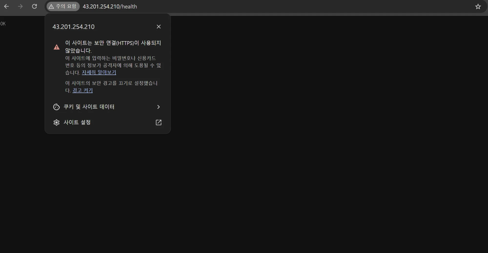
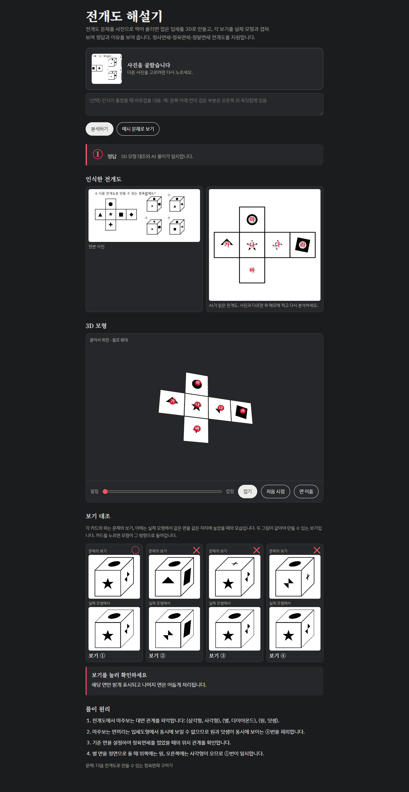
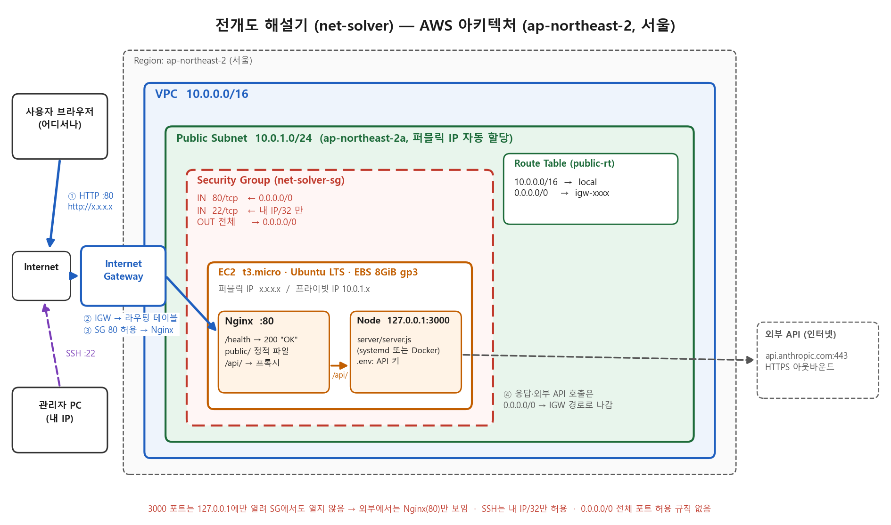

# 전개도 해설기

전개도 문제 사진을 올리면 AI가 전개도와 보기를 읽고, 페이지가 직접 접어서 3D 모형과 보기 대조로 정답을 보여 주는 웹사이트입니다. 정사면체·정육면체·정팔면체를 지원합니다.

AWS EC2 한 대(서울 리전)에 Nginx + Node로 배포합니다.

> 📌 **평가자용 바로가기**: [외부 접속 검증](#외부-접속-검증-제출-정보) · [실제 작동 증거](#실제-작동-증거-삭제-전-기록) · [아키텍처](#아키텍처) · [학습 목표 5개 쉬운 설명](#이-과제로-배운-것-학습-목표-5개-쉽게-설명) · [트러블슈팅](docs/troubleshooting.md) · [정리 체크리스트](docs/cleanup-checklist.md) · [미션 체크리스트](docs/mission-checklist.md)

## 외부 접속 검증 (제출 정보)

| 항목 | 값 |
|---|---|
| **선택한 방식** | **(B) `GET http://<퍼블릭IP>/health` → `200 OK` / `OK`** (참고: (A) 브라우저 `http://<퍼블릭IP>`로도 사이트가 열림) |
| 접속 주소 | **http://43.201.254.210/health** (사이트: http://43.201.254.210) — ⚠️ 2026-11-03 실습 종료로 리소스 삭제, 현재는 접속 불가 ([작동 증거](#실제-작동-증거-삭제-전-기록)) |
| 확인 명령 | `curl -i http://43.201.254.210/health` |
| 확인 일시 | 2026-11-02 14:54 KST, 외부(내 PC)에서 200 OK 확인 |
| 결과 스크린샷 | [docs/img/external-health.png](docs/img/external-health.png) (내 PC 크롬에서 `OK` 확인) |
| 명령 출력 기록 | [docs/evidence/ec2-instance-checks.txt](docs/evidence/ec2-instance-checks.txt), [docs/evidence/aws-resources.txt](docs/evidence/aws-resources.txt) |

> ⚠️ 주소는 반드시 **`http://`까지** 입력하세요. 스킴 없이 치면 크롬이 `https://`(443)로 먼저 시도하는데, 보안 그룹은 80만 열려 있어 시간 초과가 납니다 ([트러블슈팅 사례 3](docs/troubleshooting.md)).
>
> 
>
> 퍼블릭 IP는 인스턴스를 중지/시작하면 바뀌고, 실습 종료 후 리소스를 삭제하면 이 주소는 더 이상 열리지 않습니다.

```text
기대 결과
HTTP/1.1 200 OK
Content-Type: text/plain

OK
```

## 실제 작동 증거 (삭제 전 기록)

> 실습이 끝나 AWS 리소스를 삭제했기 때문에 지금은 위 주소로 접속되지 않습니다. 아래는 **삭제 직전(2026-11-03)** 실제 서버 `http://43.201.254.210`에서 찍은 화면입니다.
> 기능 요구사항 1~5 점검 결과(명령 출력): [docs/evidence/final-check-2026-11-03.txt](docs/evidence/final-check-2026-11-03.txt)

| # | 장면 | 무엇을 보여 주나 |
|:---:|---|---|
| 1 | [외부 `/health`](docs/img/external-health.png) | 내 PC 크롬에서 `OK` (요구사항 5-B) |
| 2 | [첫 화면](docs/img/site-home.png) | 브라우저로 `http://<퍼블릭IP>` 접속 시 페이지 표시 (요구사항 5-A) |
| 3 | [예시 문제 풀이](docs/img/site-example.png) | 정사면체 전개도 → 3D 모형 → 보기 대조, 정답 ③ |
| 4 | [문제 사진 업로드](docs/img/site-upload.png) | [시험용 정육면체 전개도 문제](docs/img/sample-problem.jpg)를 올린 모습 |
| 5 | [실제 AI 분석 결과](docs/img/site-analysis.png) | EC2 → Gemini API가 사진을 읽고, 페이지가 직접 접어 대조 → 정답 ① (실제 정답과 일치, 55초) |

**실제 AI 분석 결과 (원본 사진 → AI가 읽은 전개도 → 3D 모형 → 보기 대조)**



## 아키텍처



```
인터넷 → Internet Gateway → (라우팅 0.0.0.0/0 → igw) → Public Subnet → Security Group(80, 22=내 IP) → EC2
EC2 안:  Nginx :80 ─┬─ /health  → 200 "OK" (Nginx가 직접 응답)
                    ├─ /api/*   → Node 127.0.0.1:3000 (server/server.js)
                    └─ 그 외    → public/ 정적 파일
```

## 이 과제로 배운 것 (학습 목표 5개, 쉽게 설명)

> 어려운 말 대신 **아파트 단지**에 비유했습니다. 각 설명 끝의 👉 는 이 저장소에서 직접 확인할 수 있는 근거입니다.

### 0. 먼저 알아 둘 말 (용어 사전)

**큰 그림부터**: 내가 만든 웹사이트를 다른 사람도 보려면, **하루 종일 켜져 있는 컴퓨터**가 인터넷에 연결되어 있어야 합니다. 그런 컴퓨터를 집에 두는 대신 **아마존에게 빌려 쓴 것**이 이 과제입니다.

**🖥️ 컴퓨터와 클라우드**

| 말 | 쉬운 뜻 | 비유 |
|---|---|---|
| **서버** | 다른 사람의 요청을 받아 대답해 주는 컴퓨터 | 손님 주문을 받는 **가게** |
| **클라우드** | 남의 컴퓨터를 인터넷으로 빌려 쓰는 것 | 집을 사는 대신 **월세로 빌리기** |
| **AWS** | 아마존이 운영하는 클라우드 서비스 | 컴퓨터를 빌려주는 **임대 회사** |
| **리전 (Region)** | AWS 데이터센터(컴퓨터 창고)가 있는 지역. 이 과제는 **서울**(`ap-northeast-2`) | 임대 회사의 **서울 지점** |
| **EC2** | AWS에서 빌린 **컴퓨터 한 대**. 이 사이트가 여기서 24시간 돌아갑니다 | 빌린 **가게 건물** |
| **t3.micro** | EC2의 크기(성능) 이름. 가장 작은 축이라 무료 플랜으로 쓸 수 있음 | **작은 평수** 가게 |
| **Ubuntu** | EC2에 설치한 운영체제 (윈도우 같은 것) | 가게의 **기본 인테리어** |
| **EBS** | EC2에 붙은 저장 공간 (하드디스크). 8GB | 가게의 **창고** |

**📮 주소와 문**

| 말 | 쉬운 뜻 | 비유 |
|---|---|---|
| **IP 주소** | 인터넷에서 컴퓨터를 찾는 숫자 주소 (예: `43.201.254.210`) | **집 주소** |
| **퍼블릭 IP / 프라이빗 IP** | 퍼블릭은 바깥 누구나 찾아올 수 있는 주소, 프라이빗은 단지 안에서만 쓰는 주소 (`10.0.1.206`) | **도로명 주소** / 단지 안 **호수** |
| **Elastic IP** | 바뀌지 않게 고정해 두는 퍼블릭 IP (이번엔 안 씀) | **평생 주소** 예약 |
| **`0.0.0.0/0`** | "모든 주소", 즉 인터넷 전체 | "**누구든지**" |
| **`/32`** (예: `121.135.181.35/32`) | 딱 그 주소 **하나만** | "**이 사람만**" |
| **`127.0.0.1`** | 컴퓨터가 **자기 자신**을 부르는 주소. 바깥에서는 못 들어옴 | **집 안 방끼리** 쓰는 인터폰 |
| **포트 (Port)** | 한 컴퓨터 안의 여러 **문 번호**. 웹은 80, 관리용 접속은 22, 이 프로젝트의 계산 프로그램은 3000 | 건물의 **1번 문, 2번 문** |
| **HTTP / HTTPS** | 웹페이지를 주고받는 약속. HTTPS는 내용을 **잠가서**(암호화) 보냄, 443번 문 사용 | **엽서** / **봉투에 넣은 편지** |

**🔧 서버 안의 프로그램**

| 말 | 쉬운 뜻 | 비유 |
|---|---|---|
| **Nginx** (엔진엑스) | 80번 문에서 손님을 맞는 **웹 서버 프로그램**. 화면 파일을 주고, 계산이 필요한 요청은 Node에게 넘김 | 가게 **카운터 직원** |
| **Node** (Node.js) | 실제 계산(사진을 AI에게 보내 결과 받기)을 하는 프로그램. 3000번 문, 가게 안쪽에만 있음 | **주방 요리사** |
| **`/health`** | "가게 열려 있나요?"를 확인하는 주소. 정상이면 `OK`라고 대답 | 가게 앞 **"영업 중" 팻말** |
| **SSH** | 내 컴퓨터에서 EC2에 원격으로 들어가 명령을 내리는 방법 (22번 문) | 사장만 쓰는 **뒷문** |
| **키 페어 (.pem 파일)** | SSH로 들어갈 때 쓰는 **디지털 열쇠**. 비밀번호 대신 사용 | 뒷문 **열쇠** |
| **API / API 키** | 프로그램끼리 대화하는 창구 / 그 창구를 쓸 수 있다는 **비밀 출입증**. 이 프로젝트는 Google Gemini AI의 API를 씀 | 다른 가게에 주문하는 **전화번호와 회원 카드** |
| **`.env`** | API 키 같은 비밀을 적어 두는 파일. **GitHub에 절대 올리지 않음** | 금고 속 **비밀 쪽지** |
| **로그 (Log)** | 프로그램이 무슨 일이 있었는지 적어 두는 기록 | 가게 **영업 일지** |
| **`curl`** | 명령어로 웹 주소에 접속해 보는 도구 (브라우저 대신) | **전화로** 가게 영업 확인 |
| **200 / 404 / 502** | 웹이 돌려주는 상태 번호. 200 = 성공, 404 = 그런 페이지 없음, 502 = 안쪽 프로그램이 대답 안 함 | "네!" / "그런 메뉴 없어요" / "주방이 대답이 없어요" |

**💳 계정과 요금**

| 말 | 쉬운 뜻 | 비유 |
|---|---|---|
| **루트 계정** | AWS에 처음 가입한 **최고 관리자** 계정. 무엇이든 할 수 있어 평소엔 안 씀 | 건물주의 **만능 열쇠** |
| **IAM 사용자** | 필요한 권한만 받은 **작업용 계정** (`net-solver-lab`) | 일부 방 열쇠만 받은 **직원** |
| **프리 티어 / 무료 플랜** | 처음 가입하면 일정량을 무료로 쓰게 해 주는 제도 | **체험판** |
| **과금** | 쓴 만큼 요금이 붙는 것 | **전기 요금** |

### 1. VPC · Subnet · Route Table · Internet Gateway는 무슨 일을 하나요?

| 이름 | 비유 | 하는 일 | 이 프로젝트 |
|---|---|---|---|
| **VPC** | 담장으로 둘러싼 **우리 아파트 단지** | 다른 사람 네트워크와 분리된 나만의 공간 | `10.0.0.0/16` (단지 안 주소 약 6만 5천 개) |
| **Subnet** | 단지 안의 **한 동** | VPC를 더 작게 나눈 구역. 서버는 여기 산다 | `10.0.1.0/24` (그중 256개, 서울 2a 구역) |
| **Internet Gateway** (IGW) | 단지 **정문** | 단지와 바깥 세상(인터넷)을 잇는 유일한 문 | `igw-038259e638b1cc5bf` (AWS가 붙인 이름표) |
| **Route Table** (라우팅 테이블) | 갈림길 **표지판** | "어디로 가려면 어느 길로" 알려 주는 표 | `0.0.0.0/0 → 정문(IGW)` = "바깥 어디든 정문으로" |

**길 찾기 순서**: 손님(인터넷) → **정문**(IGW) → **표지판**을 보고 → **우리 동**(Subnet) → **경비실**(보안 그룹) → **우리 집**(EC2 서버)

표지판에 "바깥으로 가려면 정문으로"(`0.0.0.0/0 → IGW`)라는 줄이 있어야 그 동이 바깥과 통하는 **Public Subnet**이 됩니다. 이 줄이 없으면 손님이 찾아올 수도, 대답을 돌려보낼 수도 없습니다.

👉 [docs/architecture.png](docs/architecture.png)의 ①~④ 화살표, [docs/evidence/aws-resources.txt](docs/evidence/aws-resources.txt)의 라우팅 표

### 2. Security Group과 IAM은 뭐가 다른가요? 최소 권한은 왜 쓰나요?

| | **Security Group (보안 그룹)** | **IAM** |
|---|---|---|
| 비유 | 우리 집 앞 **경비원** | 관리사무소의 **열쇠 꾸러미** |
| 막는 것 | **누가 어느 문(포트)으로 들어오는지** | **누가 단지에서 무엇을 짓고 부술 수 있는지** (AWS 조작 권한) |
| 이 프로젝트 | 80번 문(웹): 누구나 · 22번 문(관리): **내 컴퓨터만** · 3000번: 아무도 못 들어옴 | 작업용 계정 `net-solver-lab`은 **서버 관련 일만, 서울에서만, 작은 서버만** 가능. 관리자 열쇠는 주지 않음 |

**최소 권한**은 "꼭 필요한 열쇠만 준다"는 약속입니다. 열쇠를 잃어버려도 **열 수 있는 문이 적으니 피해가 작습니다.**
실제로 이 계정으로 서울이 아닌 미국 지점(리전)을 들여다보려 하자 `explicit deny`("분명히 안 된다고 적혀 있음")가 나오며 막히는 것을 확인했습니다.

👉 [docs/iam-policy.json](docs/iam-policy.json) (열쇠 목록), 보안 그룹의 들어오는 문 규칙(인바운드) 딱 2줄: 80 ← 누구나, 22 ← 내 컴퓨터만

### 3. 바깥 사람이 우리 웹 서버까지 오려면 무엇이 필요한가요?

택배가 우리 집에 도착하려면 아래 **다섯 가지가 모두** 있어야 합니다. 하나라도 빠지면 도착하지 못합니다.

| # | 필요한 것 | 비유 | 확인 결과 |
|:---:|---|---|---|
| 1 | Internet Gateway가 VPC에 연결 | 단지에 **정문이 있다** | 연결됨 ✅ |
| 2 | Route Table에 `0.0.0.0/0 → IGW` | 정문 가는 **표지판이 있다** | 작동 중 ✅ |
| 3 | 서버에 **퍼블릭 IP** | 바깥에서 쓸 수 있는 **집 주소가 있다** | `43.201.254.210` ✅ |
| 4 | 보안 그룹이 **80번** 허용 | 경비원이 **손님을 들여보낸다** | 80번 문 ← 누구나 ✅ |
| 5 | 서버 안에서 **Nginx가 80번에서 대기** | 집에 **문 열어 줄 사람이 있다** | Nginx 실행 중, 서버 안에서 접속하면 200(성공) ✅ |

그리고 일부러 **닫아 둔 문**도 있습니다. 실제 계산을 하는 Node 프로그램(3000번)은 집 안(`127.0.0.1`)에서만 열려 있어서, 바깥에서는 Nginx를 통해서만 들어올 수 있습니다. 바깥에서 3000번으로 접속하면 **시간 초과로 막히는 것**을 확인했습니다.

👉 위의 [외부 접속 검증](#외부-접속-검증-제출-정보) 표와 스크린샷 ([docs/img/external-health.png](docs/img/external-health.png))

### 4. 오류가 나면 어떻게 고치나요?

**탐정처럼** 합니다. 짐작으로 아무거나 고치지 않고, 증거로 범인을 찾습니다.

```
① 증상 적기     무엇이, 언제, 어떻게 안 되나? (오류 문구, 숫자 코드)
② 용의자 세우기  원인일 수 있는 것들을 나열 (가설)
③ 증거 확인     로그·명령 결과로 용의자를 하나씩 지움 (검증)
④ 하나만 고치기  범인만 고친다 (조치)
⑤ 다시 해 보기  같은 방법으로 다시 확인 (결과)
⑥ 다시 안 생기게 문서·설정에 남긴다 (재발 방지)
```

**실제 예 (사례 3)**: 내 크롬에서만 사이트가 안 열렸습니다.
① 증상: `ERR_CONNECTION_TIMED_OUT` → ② 용의자: 서버 고장? 경비원(보안 그룹)? 브라우저? → ③ 증거: 같은 컴퓨터에서 `curl`로는 열림 → 서버와 길은 멀쩡. 크롬이 주소를 몰래 **https(443번 문)**로 바꿔 갔는데, 우리 경비원은 443번 문을 열어 준 적이 없음 → ④ 조치: 주소를 `http://`까지 입력 → ⑤ 열림 → ⑥ README에 경고 문구 추가

👉 [docs/troubleshooting.md](docs/troubleshooting.md): 직접 겪은 사례 5건, 모두 로그 증거 포함

### 5. 클라우드에서 돈은 언제 나가고, 다 쓰면 어떻게 치우나요?

클라우드는 **켜 둔 시간과 차지한 공간만큼** 돈을 내는 **렌터카**와 비슷합니다.

| 돈이 나가는 것 | 비유 | 주의할 점 |
|---|---|---|
| EC2 서버 | 렌터카를 **빌린 시간** | 켜 둔 시간만큼 |
| EBS (저장 공간) | 차를 세워 둔 **주차장** | 서버를 **꺼도(중지) 계속** 나감 |
| 퍼블릭 IP / Elastic IP | 빌려 쓰는 **주소판** | 안 쓰고 붙잡고만 있어도 나감 → 꼭 **반납(Release)** |
| NAT Gateway · 로드밸런서 · DB | 비싼 **추가 옵션** | 이번엔 만들지 않음 |

**치우는 순서는 만든 순서의 반대**입니다. 레고를 위에서부터 빼야 하듯, 서로 붙잡고 있는 것부터 풀어야 합니다.

```
서버(EC2) 끄고 삭제 → 남은 저장 공간(EBS) → 주소판(EIP) 반납 → 경비원(보안 그룹)
→ 키 페어 → 정문(IGW) 떼고 삭제 → 동(Subnet)·표지판(Route Table) → 단지(VPC) → 다음 날 요금 화면 확인
```

순서를 어기면 "아직 누가 쓰고 있어서 못 지워요"(`DependencyViolation`, 의존 관계 위반) 오류가 납니다.
이 프로젝트는 **무료 플랜 + 0원 예산 알림**을 켜 두었고, 만든 리소스 ID를 전부 적어 두었다가 실습이 끝나면 이 순서로 지웁니다.

👉 [docs/cleanup-checklist.md](docs/cleanup-checklist.md): 리소스 ID 추적표, 삭제 순서와 이유, "없음" 확인 명령

## 구조

```
public/index.html        화면 (업로드, 결과, 3D 뷰어, 보기 대조)
public/engine.js         전개도 해석·접기·보기 대조 엔진 (브라우저에서 실행)
server/server.js         API 서버 (Node 기본 모듈만 사용): 사진을 Claude 또는 Gemini API로 보내 JSON을 받아 옴
server/prompt.js         AI에게 보내는 지시문 (두 AI 공통, 인식 품질은 여기서 조정)
deploy/nginx.conf        Nginx 사이트 설정 (/health, /api 프록시, 10m 업로드, 300s 타임아웃)
deploy/net-solver.service  systemd 서비스 (Node를 127.0.0.1:3000에서 실행)
deploy/Dockerfile        (보너스) API 컨테이너 이미지
deploy/setup-ec2.sh      EC2 첫 설정 스크립트 (Nginx·Node 설치, 파일 배치, 서비스 등록)
docs/                    아키텍처, 트러블슈팅, 정리 체크리스트, IAM 정책, 학습 자료
.env.example             환경 변수 예시 (.env는 git에 올리지 않음)
```

API 키는 EC2의 `.env`(권한 600)에만 있고 브라우저로는 절대 나가지 않습니다. 사진은 저장하지 않고 요청 한 번에만 쓰입니다.

## 로컬 실행

Node 18 이상만 있으면 됩니다 (`npm install` 불필요).

```bash
cp .env.example .env        # GEMINI_API_KEY 또는 ANTHROPIC_API_KEY 채우기 (예시 문제만 볼 거면 생략 가능)
node server/server.js --static
```

http://127.0.0.1:3000 접속 → "예시 문제로 보기" → 정답 ③. `--static`은 로컬에서 Nginx 역할(정적 파일 + `/health`)까지 Node가 대신하는 개발용 옵션입니다.

## EC2 배포

AWS 쪽 준비(VPC, 서브넷, IGW, 라우팅, 보안 그룹, 키 페어, EC2)는 `docs/study-guide.md`의 "콘솔 작업 순서"를 따릅니다.

```bash
# 내 PC → EC2로 코드 복사 (.env는 따로 만들기)
scp -i net-solver-key.pem -r public server deploy package.json .env.example ubuntu@<퍼블릭IP>:~/net-solver/

# EC2 안에서
cd ~/net-solver
bash deploy/setup-ec2.sh
sudo cp .env.example /opt/net-solver/.env && sudo nano /opt/net-solver/.env   # API 키 입력
sudo chown netsolver:netsolver /opt/net-solver/.env && sudo chmod 600 /opt/net-solver/.env
sudo systemctl restart net-solver

curl -i http://localhost/           # 200
curl http://localhost/health        # OK
curl http://127.0.0.1:3000/api/health   # {"ok":true,"keyConfigured":true}
```

| 환경 변수 | 설명 |
|---|---|
| `AI_PROVIDER` | `gemini` 또는 `claude`. 비우면 키가 있는 쪽 (둘 다 있으면 Claude) |
| `GEMINI_API_KEY` | Gemini를 쓸 때. https://aistudio.google.com 에서 무료 발급 (무료 구간 데이터는 Google 서비스 개선에 쓰일 수 있음, 하루 호출 한도 있음) |
| `GEMINI_MODEL` | 선택, 기본 `gemini-3.6-flash` (무료 구간 모델. `gemini-3.8-flash`는 2026-11-02 테스트에서 응답 없음 → 트러블슈팅 사례 4) |
| `GEMINI_THINKING` | 선택, 기본 `low` (`minimal`/`low`/`medium`/`high`). 높이면 생각에 출력 한도를 다 써서 분석이 잘릴 수 있음 → 트러블슈팅 사례 5 |
| `ANTHROPIC_API_KEY` | Claude를 쓸 때. https://platform.claude.com 에서 선불 충전 (Claude Pro 구독과 별도 결제) |
| `CLAUDE_MODEL` | 선택, 기본 `claude-opus-5-5` (분석 1회 약 150~480원) |
| `ACCESS_CODE` | 선택, 정하면 이 코드를 아는 사람만 분석 가능 |
| `RATE_PER_10MIN` | 선택, IP당 10분에 허용할 분석 횟수, 기본 10 |
| `HOST` / `PORT` | 선택, 기본 `127.0.0.1` / `3000` |

## (보너스 2) Docker로 API 실행

systemd 서비스 대신 컨테이너로 Node를 띄웁니다. Nginx는 그대로 호스트에서 정적 파일과 `/health`를 맡습니다.

| 항목 | 값 |
|---|---|
| 이미지 | `net-solver:1.0` (베이스 `node:22-alpine`, `deploy/Dockerfile`로 빌드) |
| 실행 방식 | `docker run -d --restart unless-stopped --env-file .env` |
| 포트 매핑 | `127.0.0.1:3000 → 컨테이너 3000` (호스트 루프백에만 바인딩, 보안 그룹에서도 3000은 닫힘) |
| 스크린샷 | `docs/img/docker-ps.png` (컨테이너 Up), `docs/img/docker-external.png` (외부 /health 또는 브라우저) |

```bash
sudo apt-get install -y docker.io && sudo usermod -aG docker ubuntu   # 다시 로그인
sudo systemctl disable --now net-solver          # 3000 포트 충돌 방지
docker build -f deploy/Dockerfile -t net-solver:1.0 .
docker run -d --name net-solver --restart unless-stopped \
  --env-file /opt/net-solver/.env -p 127.0.0.1:3000:3000 net-solver:1.0
docker ps                                       # STATUS: Up ... (healthy)
curl -i http://localhost/                       # 인스턴스 내부 200
curl http://<퍼블릭IP>/health                   # 외부 OK
```

## 정리

**2026-11-03 정리 완료.** [docs/cleanup-checklist.md](docs/cleanup-checklist.md) 순서대로 EC2 → EBS → (Elastic IP 해당 없음) → 보안 그룹 → 키 페어 → IGW → 라우팅 테이블·서브넷 → VPC를 지웠고, 남은 리소스가 모두 `[]`인 것을 확인했습니다 ([삭제 기록](docs/evidence/cleanup-log-2026-11-03.txt)).

## 알아 둘 점

- 분석 1회마다 API 비용이 운영자 계정에 청구됩니다. 공개 전에 Anthropic 콘솔에서 월 사용 한도를 꼭 설정하세요.
- 속도 제한은 Node 프로세스 메모리 기반이라 재시작하면 초기화됩니다.
- 분석은 1~2분 걸릴 수 있습니다. Nginx `proxy_read_timeout 300s`, Node 쪽 외부 호출 제한 280s로 맞춰 두었습니다.
- 사용자가 올리는 문제는 출판사 교재일 수 있습니다. 사진을 저장하거나 다시 공개하지 않는 현재 구조를 유지하는 것이 안전합니다.
